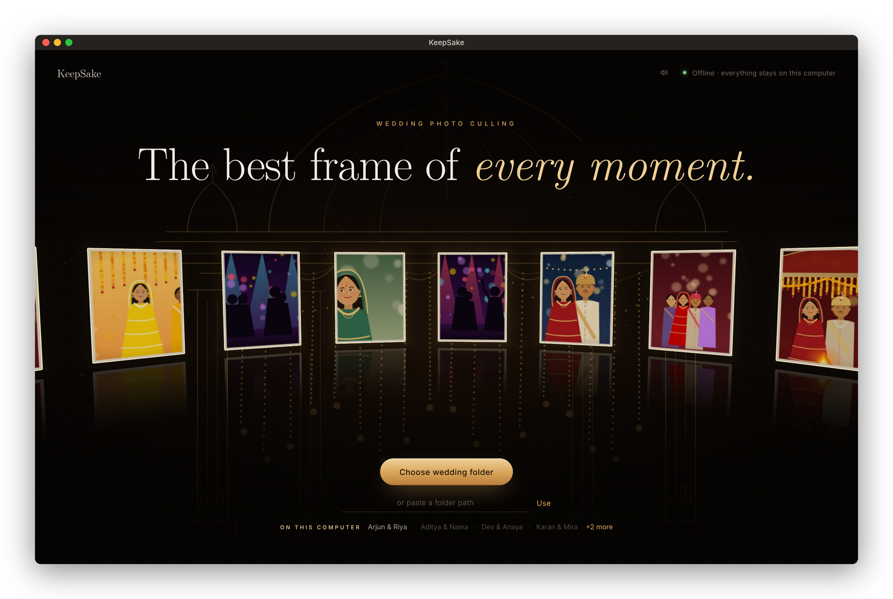
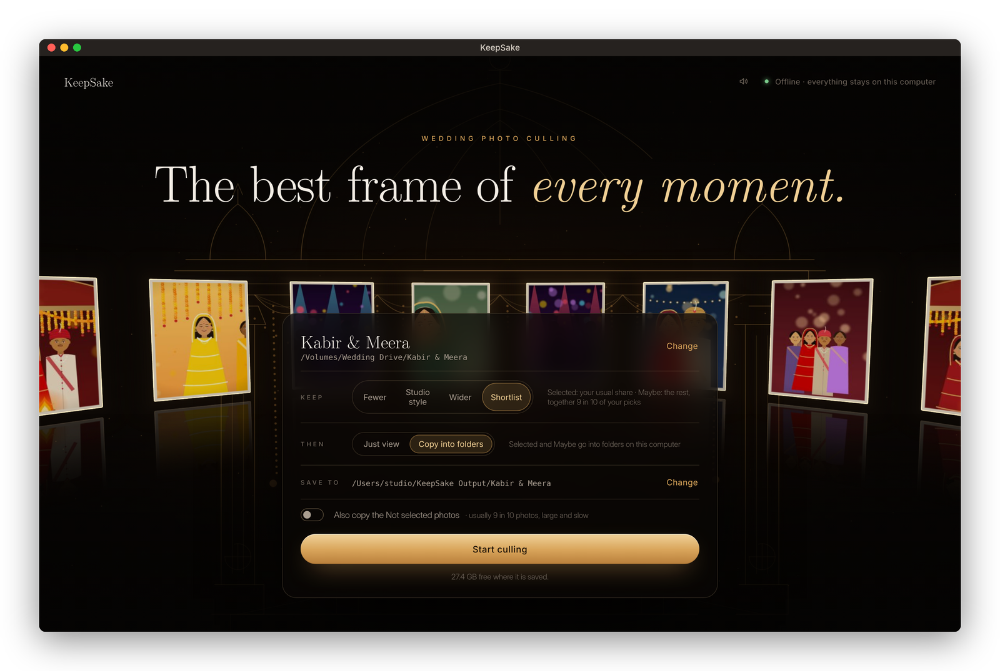
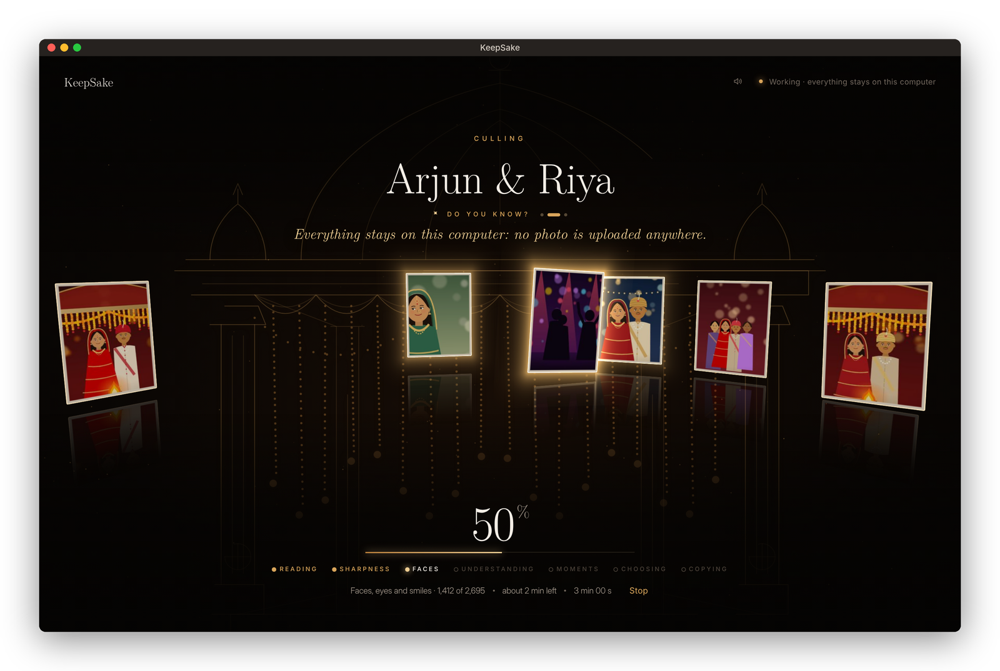
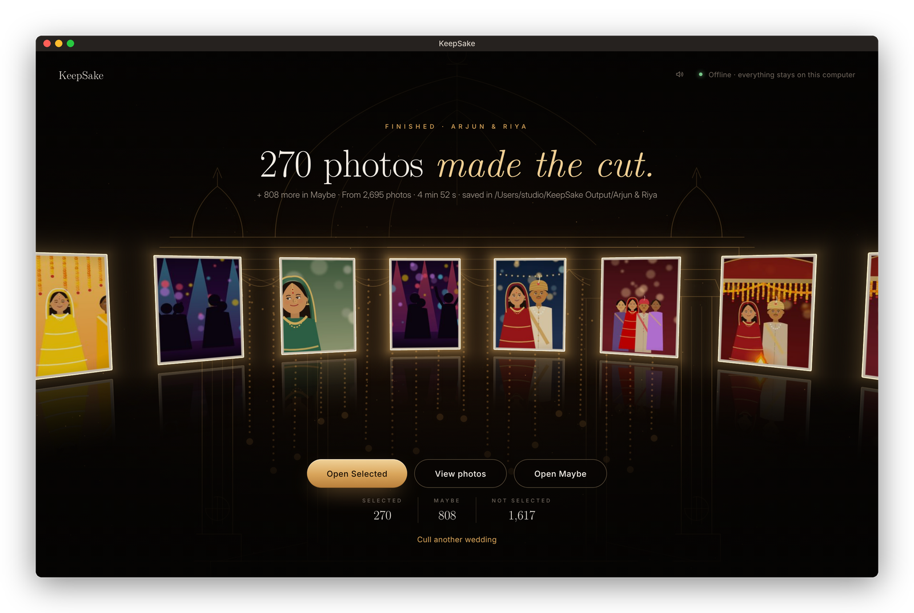
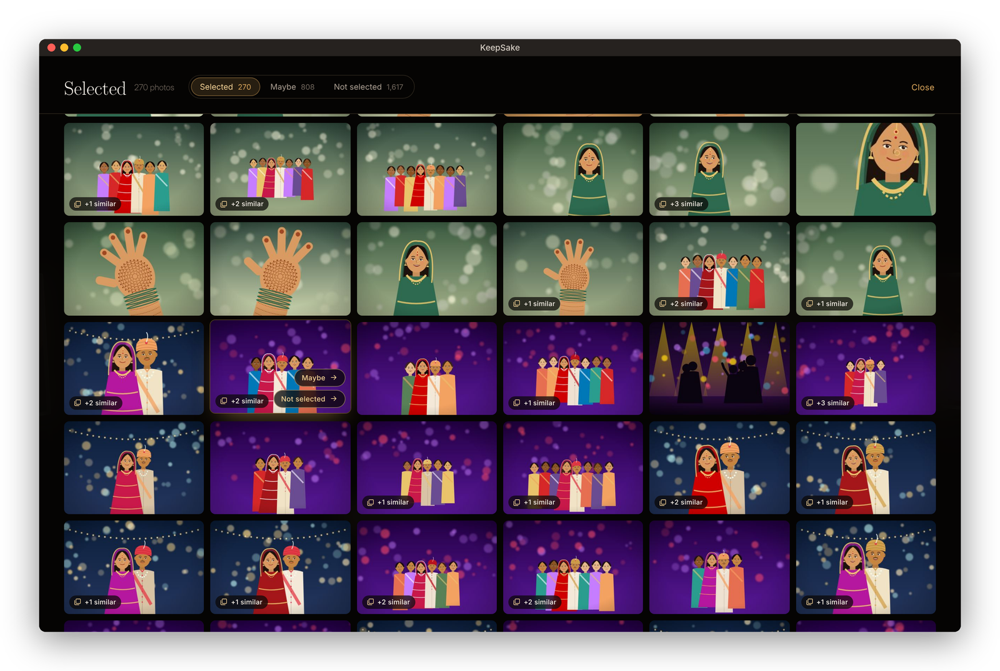
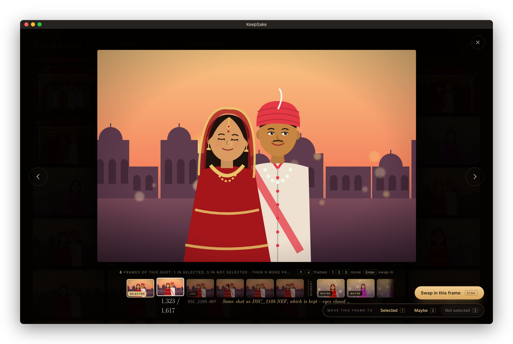
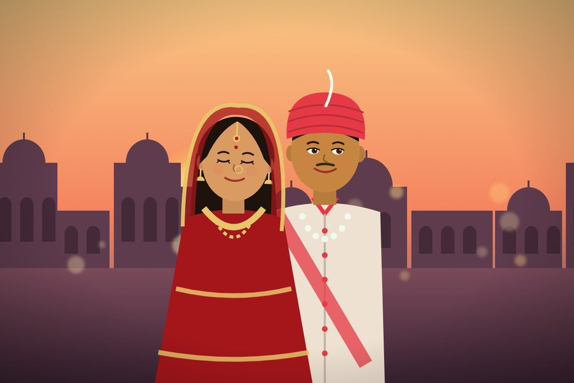
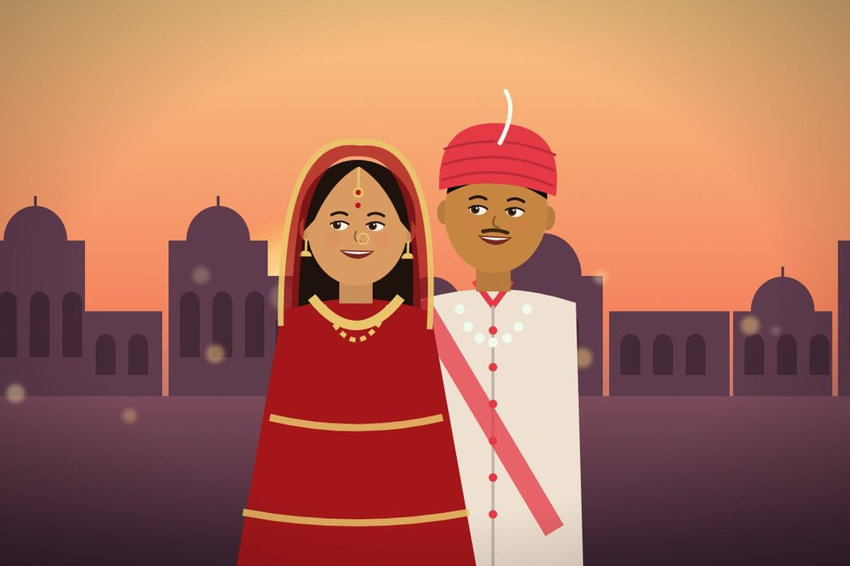
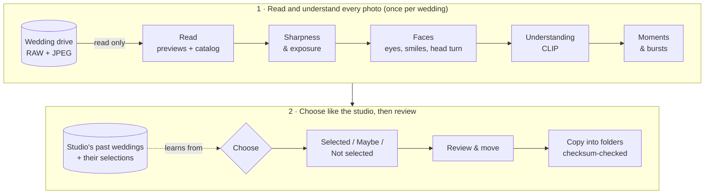

<div align="center">

# KeepSake

**The best frame of every moment.**

Offline AI photo culling for wedding studios, on Mac and Windows.




</div>

A wedding gives a studio 5,000 to 10,000 photos or more, and an editor has to look at every one
of them to pick the few hundred that go to the couple. KeepSake does the first pass. It reads the
whole wedding straight from the drive, finds the best frame of every moment, leaves out closed
eyes and turned heads, and chooses the way **this studio** chooses: it learns the studio's taste from
its own past weddings. The editor then reviews, moves any photo with one key, and KeepSake copies
everything into folders.

Nothing is uploaded. The originals are only read, never changed, moved or deleted.

> The screenshots below are the real app running on a made-up wedding ("Arjun & Riya") with drawn
> stand-in pictures. Client photos never leave the studio, so none are shown here.

## Contents

- [What it does](#what-it-does)
- [Screens](#screens)
- [How it works](#how-it-works)
- [Results so far](#results-so-far)
- [Install](#install)
- [Using KeepSake](#using-keepsake)
- [Command line](#command-line)
- [Project layout](#project-layout)
- [Building the Mac app](#building-the-mac-app)
- [Privacy and safety](#privacy-and-safety)
- [Tests](#tests)
- [Roadmap](#roadmap)

## What it does

- **Reads a whole wedding on its own.** RAW (NEF, CR3, ARW...), JPEG and HEIC from every camera,
  straight from the studio's drive. It carries on where it stopped if the drive is unplugged.
- **One best photo per shot.** Bursts and near-identical frames are grouped, and only the best
  frame of each shot goes to Selected.
- **No closed eyes, no turned heads** among the main people in Selected, when the moment has a
  better frame.
- **Chooses like the studio.** It learns from the studio's own past weddings and their final
  selections, so its picks follow the studio's style, not a generic idea of a good photo.
- **Explains every photo it leaves out**, for example *"Same shot as DSC_2108.NEF, which is kept -
  eyes closed (or lowered) on a main person in this one"*.
- **Three folders:** Selected, Maybe and Not selected. Move any photo between them with one key,
  swap in another frame of the same shot, and undo.
- **Just view, or copy.** Look through and move the photos without copying anything, or copy them
  into folders with a checksum check on every file.
- **Works offline**, on an Apple silicon Mac (its own app) or a Windows laptop.

## Screens

### 1. Choose the wedding

Pick the wedding's folder on the drive, or one read before from *On this computer*.
The opening screen is shown at the top of this page.

### 2. Set up the run



**Keep** sets how many photos go through. **Then** chooses between looking at them first (*Just view*)
and copying them into folders straight away.

### 3. While it works



Seven steps with live progress and time left. The photos it reads float through the scene, and
*Do you know?* shows the studio's own lines while it works.

### 4. Done



How many photos made the cut, how many are in Maybe, and where the folders are. When the studio's
own picks for the wedding are known, this screen also shows how many of them KeepSake found.

### 5. Review and move



Selected, Maybe and Not selected, in the order they were taken. *+2 similar* means two more frames
of the same shot are in other folders. Hover over a photo to move it, or press 1, 2 or 3 in the big view.

### 6. Every frame of a shot, and why



The big view shows the other frames of the shot (and then the rest of the moment), KeepSake's reason
for this one, and *Swap in this frame* to choose it instead.

| Left out: eyes closed | Kept: the best frame of the shot |
| :---: | :---: |
|  |  |
| *Same shot as DSC_2108.NEF, which is kept - eyes closed (or lowered) on a main person in this one* | *DSC_2108.NEF, in Selected* |

## How it works



| Step | What happens |
| --- | --- |
| **Read** | Uses the preview the camera built into each file instead of decoding the full RAW, makes an upright analysis copy (1620 px) and a thumbnail, and writes one SQLite catalog per wedding on this computer. RAW + JPEG pairs count as one photo. |
| **Sharpness & exposure** | Sharpness, noise, motion blur and brightness, each compared with the same camera body and the same event. |
| **Faces** | Finds every face (YuNet), recognises the same people across photos (SFace), and reads eyes open or closed, smile and head turn (MediaPipe Face Landmarker). |
| **Understanding** | A CLIP embedding of every photo: what it shows. |
| **Moments & bursts** | Lines up the clocks of all the cameras, groups photos of the same moment across cameras, and finds the near-identical frames of each shot. |
| **Choose** | A LightGBM model trained on the studio's past weddings, plus a content score from CLIP, rates every photo. A second model ranks the frames of each shot. The rules on top: one photo per shot, and no closed or half-closed eyes or turned heads among the main people when the moment has a better frame. |
| **Copy** | Copies each photo into Selected, Maybe or Not selected, keeping its event folder and file name, and checks every copy against a SHA-256 checksum. `ks undo` removes the copies again. |

The models are small and run on the processor: CLIP ViT-B/32 (int8, ONNX Runtime), YuNet and SFace
(OpenCV), MediaPipe Face Landmarker and LightGBM. Each model file is pinned by its SHA-256, so every
computer measures a photo exactly the same way.

## Results so far

**Accuracy**, on a wedding KeepSake did not learn from (it learned only from the other weddings),
compared with the studio's own final selection:

| | Photos | Studio's picks found | Counting a near-identical frame of the same shot |
| --- | ---: | ---: | ---: |
| Whole wedding | 3,869 | the studio picked 523 | |
| **Selected + Maybe** (Shortlist) | 1,738 (45%) | 337 of 523 (64%) | **449 of 523 (86%)** |
| Selected alone | 386 (10%) | 88 of 523 (17%) | 164 of 523 (31%) |

In other words: the Shortlist removes more than half of the wedding and still holds about 9 in 10 of
the moments the studio picked. Choosing *the* exact frame the editor chose is harder, which is why
Shortlist (Selected + Maybe) is the default. Measured on the Windows laptop. That run includes
19 photos moved by hand during review, so the numbers can differ by a point or two without them.

**Speed:**

| Computer | Photos | Time |
| --- | ---: | ---: |
| iMac M4 (studio's finished JPGs) | 7,558 | about 10 min |
| Windows laptop (RAW, past weddings) | about 6,000 | about 22 min |

A wedding read once is quicker the next time: only new or changed photos are read again.

## Install

### Mac (Apple silicon, macOS 14 or later)

1. Open `KeepSake.dmg` and drag **KeepSake** onto **Applications**.
2. Open KeepSake from Applications. The app is not signed with an Apple developer account yet, so
   macOS may say *"Apple could not verify KeepSake"*: click **Done**, then **System Settings ->
   Privacy & Security -> Open Anyway**.
3. **Bring the studio's learned style, once per computer, before the first wedding.** On the opening
   screen click *"First time on this computer? Bring your studio's learned style"* and choose the
   `KeepSake Mac` folder on the pen drive. It copies the past weddings' catalogs and learned features
   (no photos are needed).

The link appears only while the Mac has no weddings. If a wedding was run before, copy the kit in
Terminal instead (it only adds files, and never replaces or deletes anything):

```bash
kit="/Volumes/<pen drive>/KeepSake Mac"; [ -d "$kit/data" ] && kit="$kit/data"; d="$HOME/Library/Application Support/KeepSake"; mkdir -p "$d"; cp -Rnp "$kit/" "$d/"; echo "Weddings now: $(ls "$d/cache" | wc -l | tr -d ' ')"
```

The Mac app keeps its data in `~/Library/Application Support/KeepSake` and saves folders to
`~/KeepSake Output`. The app is built for Apple silicon (M1 or newer); Intel Macs are not supported.

### Windows

Open PowerShell and run:

```powershell
cd C:\KeepSake
powershell -ExecutionPolicy Bypass -File .\setup.ps1
```

It installs Python 3.11, Git and ExifTool if missing, creates the Python environment, makes the
folders and checks everything. It is safe to run again at any time (`ks setup` does the same).
Then download the AI models (checked against their SHA-256) and open the app:

```powershell
ks models
ks app
```

It opens in its own window (Edge or Chrome in app mode) and saves folders to `C:\KeepSake Output`.

## Using KeepSake

1. **Choose wedding folder**, or click a wedding under *On this computer*.
2. **Keep:**

   | Option | Selected holds |
   | --- | --- |
   | Fewer | about 7 in 100 photos |
   | Studio style | about 1 in 10, the studio's usual share |
   | Wider | 1.5x the studio's share: catches more of its picks |
   | **Shortlist** (default) | Selected: the studio's usual share. Maybe: the rest, together about 9 in 10 of the studio's picks |

3. **Then:** *Just view* (nothing is copied, and you can move photos straight away) or *Copy into
   folders*. *Also copy the Not selected photos* is off by default: they are usually 9 in 10
   photos, large and slow to copy, and are listed in a file instead.
4. **Start culling.** Keep the computer awake until it finishes.
5. **View photos**: move any photo with the buttons or the keys 1 (Selected), 2 (Maybe) and
   3 (Not selected), use ↑ ↓ to go through the frames of a shot, and Enter to swap one in.

Moves made while just viewing are kept: cull the same wedding again with *Copy into folders* and
they are applied.

## Command line

Every step of the app can also be run on its own. On Windows, run these inside `C:\KeepSake`.
In the Mac app, the same steps run as `KeepSake --run <step>`, for example
`/Applications/KeepSake.app/Contents/MacOS/KeepSake --run selfcheck`.

| Command | What it does |
| --- | --- |
| `ks app` | Opens the KeepSake window |
| `ks prepare "E:\Wedding"` | Every analysis step for one or many weddings, unattended (resumes if stopped) |
| `ks prepare "D:\All Raw images" --selected "E:\All Selected images"` | Prepares many past weddings and matches the studio's picks, to learn from |
| `ks cull "E:\Wedding" --shortlist` | Chooses Selected and Maybe (also `--wide 1.5`, `--keep 15`) |
| `ks apply "E:\Wedding" "C:\KeepSake Output\Wedding"` | Copies the result into folders, checksum-checked |
| `ks undo "C:\KeepSake Output\Wedding"` | Removes the copies `apply` made (only unchanged ones) |
| `ks match "D:\Wedding"` | Matches the studio's selected photos to their originals (the labels to learn from) |
| `ks blindtest --shortlist --numbers` | Tests every past wedding blind: learns from the others, then compares with the studio |
| `ks speedtest` | Finds the fastest number of workers for this computer (about 5 minutes) |
| `ks models` | Downloads the AI model files and checks their SHA-256 |
| `ks check` | Checks the tools and this computer |
| `ks test` | Runs the automatic tests |
| `ks judge "Wedding" --test` | Optional experiment: Claude as a second editor on 400 photos (paid API, asks before spending) |

## Project layout

```
KeepSake/
  app/
    keepsake_app.py     the app: a small local server and its window (127.0.0.1 only, secret key per start)
    keepsake_main.py    the packaged app's start-up: the window, or one step with --run <step>
    ui/                 the interface: HTML, CSS and JavaScript (the opening scene, gallery, big view)
  engine/               the AI engine: catalog, reading, quality, faces, CLIP, moments, learning, culling, copying
  scripts/              one script per step (ks.cmd runs them; the Mac app runs them with --run)
  tests/                automatic tests (run on Windows and macOS)
  packaging/            the Mac app: PyInstaller recipe, pinned library versions, version number
  .github/workflows/    build.yml: tests on Windows and Mac, builds and checks the Mac app
  docs/                 notes, speed results and these screenshots
  data/                 PHOTO DATA - never in Git: catalogs, analysis copies, the studio's labels
  tools/                AI models and ExifTool, downloaded - not in Git
```

## Building the Mac app

There is no need to own a Mac to build it. `.github/workflows/build.yml` runs on GitHub's Apple
silicon Macs whenever the code changes on `main` or a `mac-*` branch (or by hand from the Actions tab):

1. Runs the tests on Windows and on macOS.
2. Installs the same library versions as the studio's Windows laptop
   (`packaging/requirements-mac.txt`), so a photo is measured the same on both.
3. Downloads the AI models (checked against their SHA-256) and ExifTool.
4. Builds `KeepSake.app` with PyInstaller (`packaging/KeepSake.spec`) and packs `KeepSake.dmg`.
5. Checks the app from inside the .dmg: `--run selfcheck` must pass all 10 checks (every library,
   every model, ExifTool, a LightGBM training run, the catalog and the data folder).
6. Culls a made-up sample wedding with the packaged app, starts a run through the app's own
   window, and takes screenshots of it.

The .dmg is under the run's **Artifacts** on GitHub (Actions -> Build and test).

## Privacy and safety

- **Offline.** Everything runs on the studio's computer. No photo is uploaded anywhere; the app
  only listens on 127.0.0.1, with a new secret key every time it starts.
- **The originals are read-only.** KeepSake never writes to the wedding drive. Copies are checked
  against a SHA-256 checksum, and `ks undo` removes only the copies it made.
- **Photos never go in Git.** `data/` and every photo file type are ignored, and `ks setup` checks that
  no photo is tracked. The screenshots in this README use drawn stand-in pictures.
- **No client names in the code.** Examples and tests use made-up names.

## Tests

More than 140 automatic tests cover reading, quality, faces, moments, learning, culling, copying,
the app's server and the Mac app's plumbing. They run on Windows and macOS on every push:

```powershell
ks test
```

## Roadmap

- [x] Read a whole wedding from the drive, resumable
- [x] Sharpness, exposure, faces, eyes, smiles, head turn
- [x] Moments and bursts across cameras
- [x] Learn the studio's style from its past weddings
- [x] Selected / Maybe / Not selected, with a reason for every photo left out
- [x] The app: review, move, swap frames, undo, just view or copy
- [x] Mac app (Apple silicon), built and checked automatically
- [x] Bring the learned style to a new computer from a pen drive
- [ ] Measure accuracy on more weddings, RAW speed on the studio's iMacs
- [ ] App icon, and signing with an Apple developer account
- [ ] Windows installer

---

<div align="center">

Built by **Kavita Dhamal**, for a wedding photography studio in India.

</div>
